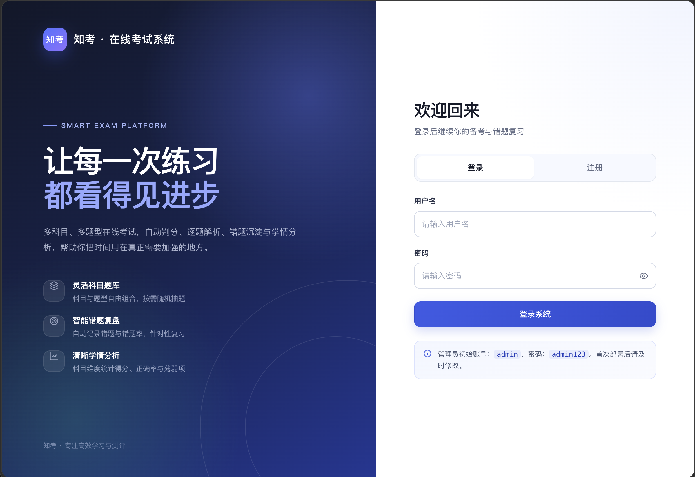
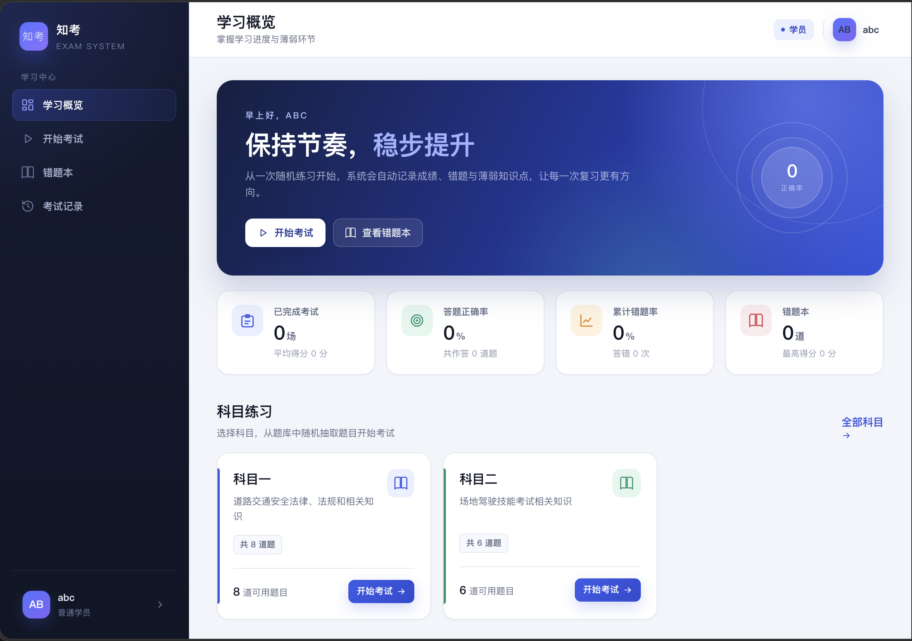
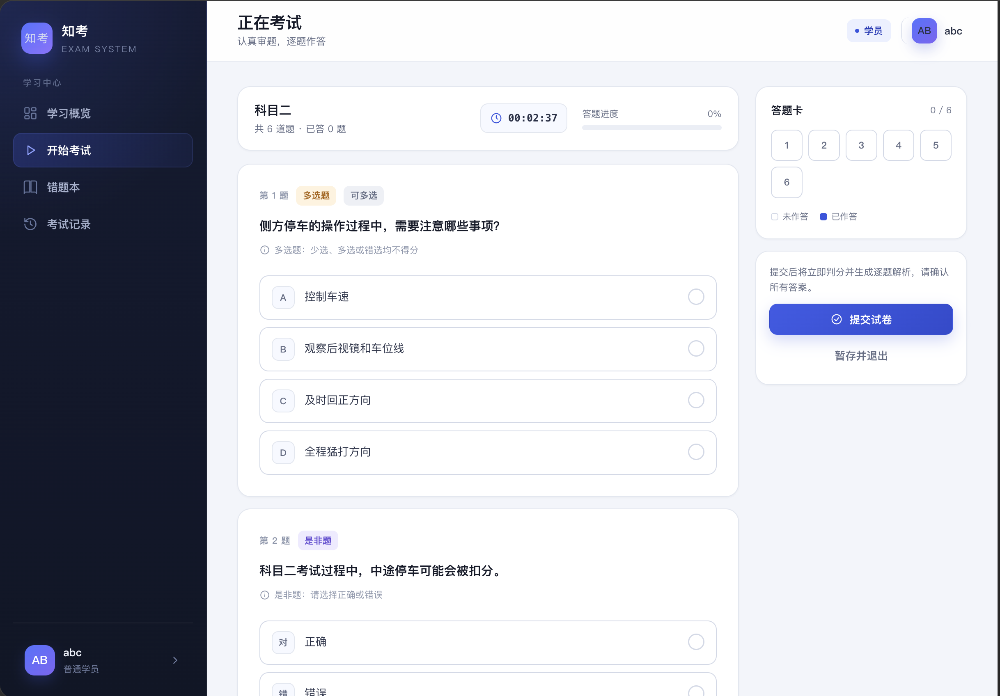
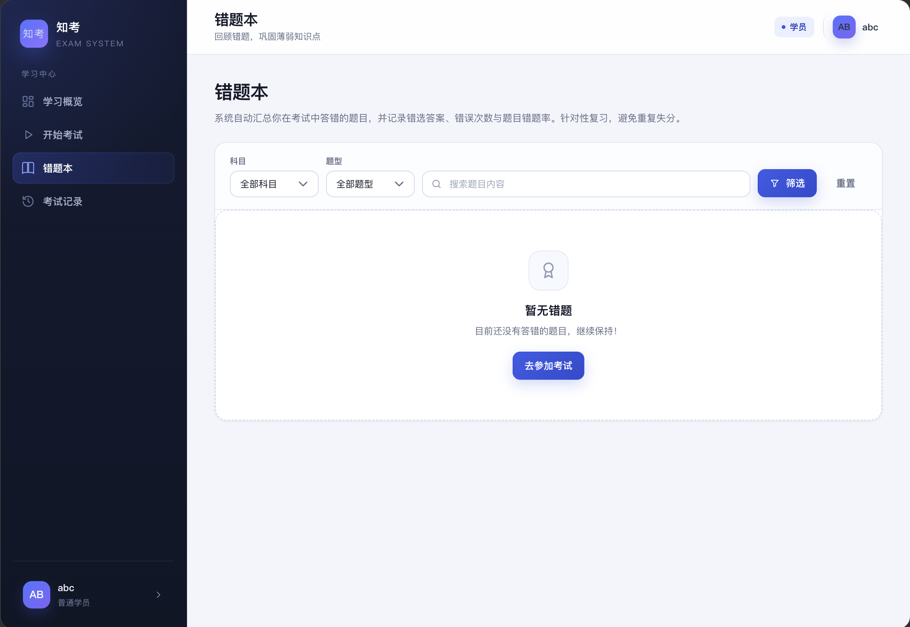

# 知考 · 在线考试系统

一个前后端一体的在线考试网站。后端使用 Python Flask，数据存储使用 SQLite3，前端使用原生 HTML/CSS/JavaScript，无需 Node.js 或打包构建即可运行。前端静态资源由 Flask 同源托管，前后端统一使用一个端口；支持 Docker 单端口部署，并提供 MCP 协议接口用于外部工具集成。

## 功能

### 学员端

- 注册、登录、登录状态保持
- 按科目参加考试，可自选抽题数量，题目随机抽取
- 支持单选题、多选题、是非题，提交后自动判分
- 查看成绩、正确率、错题率、用时与逐题答案解析
- 错题本：按科目、题型、关键词筛选，展示错选答案、错误次数、题目错题率
- 考试记录：查看历史成绩，继续未完成的考试
- 答题进度自动暂存，刷新或重新登录后可继续作答
- 个人设置：点击头像可修改用户昵称和登录密码，昵称会同步显示在侧边栏、顶栏和首页问候语中

### 管理员端

- 科目管理：新增、编辑、删除科目（如科目一、科目二）
- 题库管理：单选、多选、是非题的新增、编辑、删除、筛选与搜索
- 用户管理：新增用户、调整角色、启用/停用账号、重置密码、删除用户
- 网站设置：配置网站系统名称和网站详细介绍，实时应用到登录页的品牌标识、浏览器标题和界面介绍
- 权限隔离：普通用户无法访问管理接口和后台页面
- 题目及科目删除采用软删除，已有考试记录与历史解析不会被破坏

### 部署与集成

- Docker：提供前后端一体化单端口镜像、构建脚本和启动入口，支持 SQLite 数据卷持久化
- MCP：提供 Streamable HTTP JSON-RPC 服务，支持管理员登录、查询科目与题库、新增/修改/删除科目和题目，并可通过题目接口调整所属科目

## 样例

演示网站：<http://www.lixiangyun.top:5001>

### 登录页面



### 学习概览



### 在线考试



### 错题本



## 技术结构

```text
考试系统/
├── backend/
│   ├── __init__.py          # Flask 应用工厂、CORS、蓝图注册
│   ├── auth.py              # 签名 Token、登录/管理员权限装饰器
│   ├── catalog.py           # 科目与题库共享业务逻辑
│   ├── db.py                # SQLite 连接与初始化
│   ├── schema.sql           # 数据表结构
│   ├── seed.py              # 初始管理员与演示题库
│   ├── validators.py        # 用户名、密码、题目选项校验
│   ├── routes/
│   │   ├── auth_routes.py   # 注册、登录、当前用户、个人设置
│   │   ├── subjects.py      # 科目列表
│   │   ├── admin.py         # 用户/科目/题库/网站设置管理
│   │   ├── settings.py      # 网站信息公开读取
│   │   ├── mcp_routes.py    # MCP JSON-RPC 服务
│   │   ├── exams.py         # 开始考试、进度、交卷、记录
│   │   └── stats.py         # 学情统计、错题本
│   └── tests/test_api.py    # 后端接口自动化测试
├── frontend/
│   ├── index.html           # 单页应用入口
│   ├── css/styles.css       # 响应式界面样式
│   └── js/
│       ├── config.js        # 同源后端接口地址
│       ├── api.js           # API 请求与 Token 管理
│       └── app.js           # 路由、页面渲染与交互
├── data/                    # SQLite 数据文件目录
├── Dockerfile               # 前后端一体化单端口镜像构建文件
├── docker-entrypoint.sh     # 容器启动入口，读取端口并启动服务
├── build-docker.sh          # Docker 镜像构建脚本
├── run.py                   # 后端启动入口
├── start.sh                 # 一键启动前后端
└── requirements.txt
```

前端静态资源由 Flask 直接托管，浏览器访问的页面和 `/api/*` JSON 接口使用同一个端口，默认端口为 `5001`。


## 镜像安装

```bash
  docker run -d --name exam-system \
    -p 5001:5001 \
    -e EXAM_SECRET_KEY='请替换为随机密钥' \
    -v exam-system-data:/app/data \
    linimbus/exam-system:latest
```

## 本地部署

要求：Python 3.10+，无需 Node.js。

```bash
chmod +x start.sh
./start.sh
```

打开浏览器访问：<http://127.0.0.1:5001>

初始管理员账号：

```text
用户名：admin
密码：admin123
```

首次启动会自动创建 SQLite 数据库 `data/exam.db`，并写入两套演示科目题库。登录后可在“用户管理”中修改管理员密码。

也可以不通过脚本手动启动：

```bash
# 默认监听 127.0.0.1:5001，同时提供前端页面和 /api 接口
python3 run.py

# 指定端口
EXAM_PORT=8080 python3 run.py
```

## Docker 运行

要求：Docker 20.10+。镜像内的 Flask 服务同时托管前端静态资源和后端 API，只暴露一个端口，默认 `5001`。

### 使用构建脚本构建

```bash
chmod +x build-docker.sh

# 使用默认端口 5001
./build-docker.sh

# 位置参数：服务端口
./build-docker.sh 8080

# 命名参数：指定端口、镜像名和标签
./build-docker.sh -p 8080 -i exam-system -t v1.0.0
```

### 直接使用 docker build

```bash
docker build \
  --build-arg PORT=5001 \
  -t exam-system:latest .
```

### docker run 启动

```bash
docker run -d --name exam-system \
  -p 5001:5001 \
  -e EXAM_SECRET_KEY='请替换为随机密钥' \
  -e EXAM_ADMIN_PASSWORD='请替换为管理员密码' \
  -v exam-system-data:/app/data \
  exam-system:latest
```

启动后访问 <http://127.0.0.1:5001> 即可打开前端页面；接口和 MCP 服务同样使用该端口：

- API：<http://127.0.0.1:5001/api>
- MCP：<http://127.0.0.1:5001/api/mcp>

如果使用 `8080` 构建镜像，启动时映射对应端口即可：

```bash
docker run -d --name exam-system \
  -p 8080:8080 \
  -e EXAM_SECRET_KEY='请替换为随机密钥' \
  -v exam-system-data:/app/data \
  exam-system:latest
```

说明：

- SQLite 数据库保存在容器内 `/app/data/exam.db`，通过 `-v exam-system-data:/app/data` 持久化。
- 前端和 API 同源，无需额外配置 CORS。
- 查看日志：`docker logs -f exam-system`；停止服务：`docker stop exam-system`。

## 配置项

通过环境变量配置后端：

| 变量 | 默认值 | 说明 |
| --- | --- | --- |
| `EXAM_DATABASE` | `data/exam.db` | SQLite 数据库文件路径 |
| `EXAM_SECRET_KEY` | 开发用默认值 | Token 签名密钥，生产环境必须修改 |
| `EXAM_TOKEN_MAX_AGE` | `604800` | Token 有效期（秒），默认 7 天 |
| `EXAM_ADMIN_USERNAME` | `admin` | 首次初始化时创建的管理员用户名 |
| `EXAM_ADMIN_PASSWORD` | `admin123` | 首次初始化时创建的管理员密码 |
| `EXAM_SEED_DEMO` | `1` | 是否写入演示科目题库，设为 `0` 关闭 |
| `EXAM_CORS_ORIGINS` | 本地开发地址 | 允许跨域访问 API 的地址，同源部署通常无需配置 |
| `EXAM_HOST` / `EXAM_PORT` | `127.0.0.1` / `5001` | 服务监听地址和端口 |
| `EXAM_FRONTEND_DIR` | `frontend/` | 前端静态资源目录 |

管理员账号和演示数据只会在数据库为空时初始化。修改环境变量后不会覆盖已有账号，请通过后台或数据库处理。

前端 API 地址位于 `frontend/js/config.js`，默认使用同源 `/api`。需要连接独立后端时，可在页面加载前设置 `window.EXAM_API_BASE`。

Docker 镜像支持 `PORT` 或 `EXAM_PORT` 环境变量（默认 `5001`）控制唯一服务端口，也可以通过 `docker build --build-arg PORT=8080` 设置镜像默认端口。

## 运行测试

```bash
python3 -m pytest -q
```

测试覆盖注册登录、权限校验、用户管理、科目与题目 CRUD、MCP 协议与工具调用、考试抽题、答题进度、交卷判分、错题本与学情统计。

## 主要 API

所有业务接口都需要请求头 `Authorization: Bearer <token>`，注册和登录接口除外。

| 方法 | 路径 | 说明 |
| --- | --- | --- |
| POST | `/api/auth/register` | 注册并返回 Token |
| POST | `/api/auth/login` | 登录并返回 Token |
| GET | `/api/auth/me` | 当前用户信息 |
| PATCH | `/api/auth/profile` | 修改当前用户昵称/密码 |
| GET | `/api/settings` | 读取网站名称与详细介绍（公开） |
| GET | `/api/subjects` | 科目列表与题型数量 |
| POST | `/api/exams/start` | 开始考试并随机抽题 |
| PATCH | `/api/exams/{id}/progress` | 暂存答题进度 |
| POST | `/api/exams/{id}/submit` | 交卷并判分 |
| GET | `/api/exams` | 考试记录分页 |
| GET | `/api/exams/{id}` | 考试详情；交卷后包含答案与解析 |
| GET | `/api/stats/summary` | 学情概览与科目统计 |
| GET | `/api/wrong-questions` | 错题本分页与筛选 |
| POST | `/api/admin/subjects` | 新增科目 |
| PATCH/DELETE | `/api/admin/subjects/{id}` | 修改/删除科目 |
| GET/POST | `/api/admin/questions` | 题库分页查询/新增 |
| PATCH/DELETE | `/api/admin/questions/{id}` | 修改/删除题目 |
| GET/POST | `/api/admin/users` | 用户列表/新增 |
| PATCH/DELETE | `/api/admin/users/{id}` | 修改/删除用户 |
| GET/PATCH | `/api/admin/settings` | 读取/修改网站名称与详细介绍 |

题目接口使用 `qtype` 表示题型：

- `single`：单选题，`answer` 只能有一个选项标识
- `multiple`：多选题，`answer` 可包含多个选项标识
- `judge`：是非题，正确答案为 `["T"]` 或 `["F"]`

选择题的选项标识由后端按顺序生成为 `A`、`B`、`C` 等；是非题固定为“正确 / 错误”。

## MCP 服务

后端提供基于 Streamable HTTP 的无状态 MCP 服务，入口为：

```text
POST http://127.0.0.1:5001/api/mcp
```

支持 MCP `initialize`、`ping`、`tools/list`、`tools/call` 和通知消息。客户端通过 POST 发送 JSON-RPC 2.0 请求即可；通知消息返回 `202 Accepted`。

### 可用工具

| 工具 | 说明 |
| --- | --- |
| `admin_login` | 管理员登录，返回后续工具使用的 token |
| `list_subjects` | 查询所有科目信息、题目数量和题型分布 |
| `list_questions` | 分页查询题库，可按科目、题型、关键词筛选 |
| `get_question` | 按 ID 查询题目详情、答案与解析 |
| `create_subject` | 新增科目 |
| `update_subject` | 修改科目名称、描述和排序 |
| `delete_subject` | 删除科目（软删除） |
| `create_question` | 新增题目并配置所属科目 |
| `update_question` | 修改题目或调整题目所属科目 |
| `delete_question` | 删除题目（软删除） |

管理工具需要管理员 token。token 可以放在工具参数 `token` 中，也可以通过请求头传递：

```text
Authorization: Bearer <token>
```

### 调用示例

初始化：

```bash
curl -s http://127.0.0.1:5001/api/mcp \
  -H 'Content-Type: application/json' \
  -d '{
    "jsonrpc": "2.0",
    "id": 1,
    "method": "initialize",
    "params": {
      "protocolVersion": "2025-06-18",
      "capabilities": {},
      "clientInfo": {"name": "curl", "version": "1.0"}
    }
  }'
```

管理员登录：

```bash
curl -s http://127.0.0.1:5001/api/mcp \
  -H 'Content-Type: application/json' \
  -d '{
    "jsonrpc": "2.0",
    "id": 2,
    "method": "tools/call",
    "params": {
      "name": "admin_login",
      "arguments": {"username": "admin", "password": "admin123"}
    }
  }'
```

查询科目：

```bash
curl -s http://127.0.0.1:5001/api/mcp \
  -H 'Content-Type: application/json' \
  -H 'Authorization: Bearer <token>' \
  -d '{
    "jsonrpc": "2.0",
    "id": 3,
    "method": "tools/call",
    "params": {"name": "list_subjects", "arguments": {}}
  }'
```

## 数据说明

- 密码使用 Werkzeug 的密码哈希存储，不保存明文。
- 登录凭证为带签名的限时 Token，不使用明文用户 ID。
- 管理员不能停用、降级或删除自己的账号，系统会保留至少一名启用状态的管理员。
- 学员只能访问自己的考试记录与错题数据。
- 删除用户会同时删除其考试记录；删除科目/题目为软删除，历史记录仍可查看。
- 初始化完成后建议立即修改管理员密码，并设置独立的 `EXAM_SECRET_KEY`。

## 生产部署建议

开发环境的一键启动使用 Flask 内置服务器，同时托管前端页面和 API。生产环境建议：

- 使用 Gunicorn/uWSGI 运行 Flask 应用；
- 使用 Nginx 反向代理同一个服务端口，或由 Nginx 直接托管 `frontend/` 并转发 `/api`；
- 设置强随机的 `EXAM_SECRET_KEY`、修改默认管理员密码；
- 同源部署时无需配置 `EXAM_CORS_ORIGINS`，跨域部署时再限制为实际前端域名；
- 定期备份 `data/exam.db`。
